# Portaler

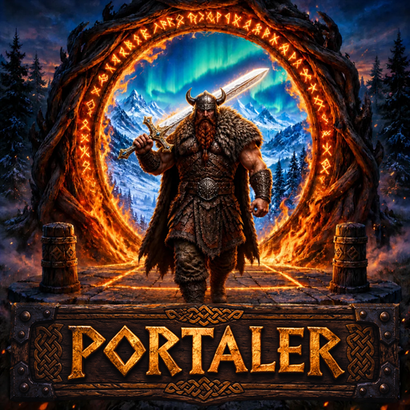

**The best portal mod for Valheim!!!** Every portal connects to every portal, with one-way links, coloured portals, a live map preview, shared favorites, categories, search, your friends' last trips and much more.

Step into any portal and the map opens with a list of all portals on the server. Pick a name or click a pin and you're there. There's no pairing and no tag matching, and by default no item restrictions.

Rest the mouse on a name and the map shows where it goes, with a fiery line from your portal to the target.

Built for servers that play together:
- **One-way links**: link a portal straight to one destination, like vanilla pairs, with its name floating above it.
- **Portal colours**: runes and fire in 8 ready colours or any colour from the picker, shown on the map and in the list too.
- **Favorites**, personal (silver) or shared with everyone (gold), in your own order.
- **Categories** with icons on the list and the map pins (base, mine, farm, trader, boss, danger, dungeon, explore), plus a one-click filter.
- **Players' last trips**: see where your friends went and follow them with one click.
- **Back to**: your last 1-3 departure portals, one click away.
- **Last built**: the newest portals on the server.
- **Search, sorting** (biome, name, distance), foldable groups and blocks you can drag into your own order.
- **Fast**: trips take about 4-6 s instead of the game's 9-10 s (you arrive as soon as the target area is loaded), the map opens without a freeze, and the list uses under 2 ms per frame.
- **Automatic names** by biome (`BF-007`, `MO-012`), and one compact **Edit portal** window (**E**) for name, type and colour.
- **Back to your grave**: after a death, the first portal offers the portal nearest your grave and your last trip, one key press away.
- **Gamepad support**: the list and all its windows work with a controller (Steam Deck too).
- **Arrow keys**: move through the list and travel without the mouse.

Everybody has the same rights: anyone can rename, set categories or change shared favorites. Everything shared is synced through the server and kept with the world save, so it survives restarts and mod updates.

## Screenshots

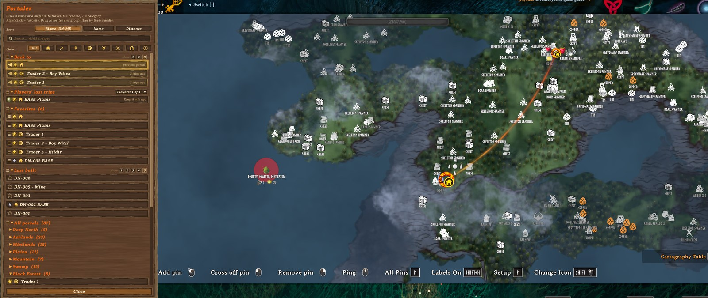

Source code, issues and ideas: **[github.com/nfp007/portaler](https://github.com/nfp007/portaler)**

## Features

Every feature says what is **🌐 shared** (the same for everybody on the server) and what is **👤 personal** (only for you).

**1. Travel from any portal to any portal**
- Walk into a portal: the big map opens with the portal list on the left.
- Click a name in the list, or a portal pin on the map, to travel.
- Vanilla name pairing is switched off, so every portal is always active.
- The portal you stand in stays in the list, greyed out with "you are here", and cannot be selected.
- 🌐 Shared: the list of portals (everybody sees every portal).

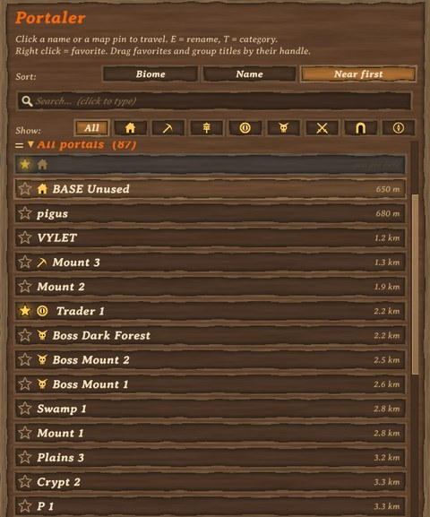

**2. Map preview**
- Rest the mouse on a name: a soft fiery line flows from your portal to it and its pin gets bigger, so you see where the trip goes.
- Close portals (up to 2 km apart): the map calmly frames **both** portals, with extra room around the target.
- Far portals: the map shows the target right away, without flying across the world.
- The map stays there 10 seconds after the mouse leaves the list, then glides back. Move or zoom the map yourself and it stays where you put it.
- 👤 Personal: only your own map moves. Timing, zoom and the line can be changed in your config.

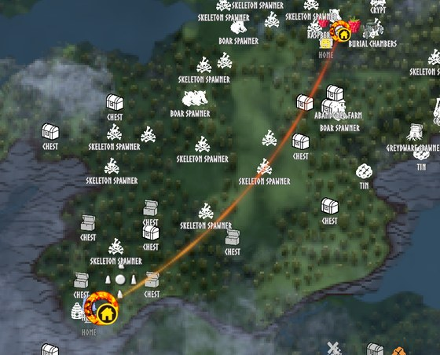

**3. Favorites**
- Click the star of a name (or right click → Favorite): **mine** (silver star), then **shared** (bigger glowing gold star), then off.
- Drag favorites by their handle into any order. New favorites go to the end.
- 🌐 Shared: gold stars. Everybody sees them, and anyone can add or remove them.
- 👤 Personal: silver stars and the order of your favorites (per character, saved on the server).

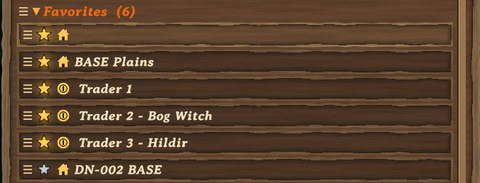

**4. Categories & filter**
- Hover a name and press **T** to choose a category: Base, Mine, Farm, Trader, Boss, Danger, Dungeon or Explore. It can also be set right in the rename window (**E**).
- The icon shows in the list and inside the portal's ring on the map.
- One click on an icon in the **Show:** row lists only that category. Click it again (or **All**) to see everything.
- 🌐 Shared: the category of each portal (anyone can change it).
- 👤 Personal: which category you are filtering by.

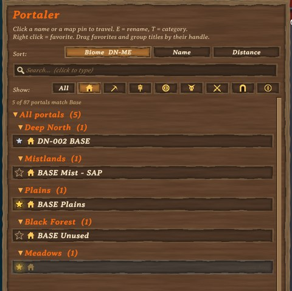

**5. Search**
- Click the search box and type: only portals whose name contains the text are shown (any case), matching letters in gold.
- While typing, the game ignores your keys (no walking, the map stays open). Esc or x clears the search.
- 👤 Personal: your search (cleared each time you enter a portal).

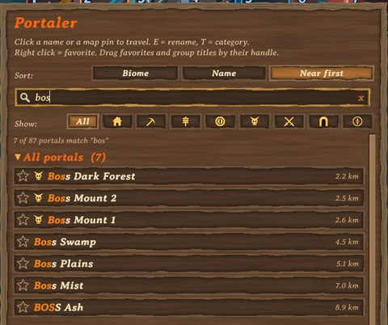

**6. Sorting & foldable groups**
- **Biome** (default): grouped by biome, Deep North first. Click again for Meadows first.
- **Name**: one list A to Z, or Z to A.
- **Distance**: nearest first (or farthest first). The distance is shown next to every name in any sorting (setting `DistanceOnEveryRow`).
- Click a group title to fold or unfold it.
- Blocks, from the top by default: **Back to**, **Players' last trips**, **Favorites**, **Last built**, **All portals** (the biome groups, or the sorted list). Each has a handle left of its title: drag them into any order, for example put Last built below all portals.
- 👤 Personal: sort choice (per PC), folded groups and group order (per character).

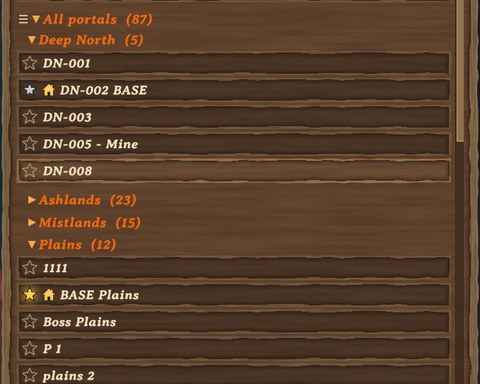

**7. "Back to"**
- The portals you last travelled from, at the top of the list. One click takes you back.
- The newest one is golden and glows; older ones say "2 trips ago", "3 trips ago".
- **show 1 2 3** in the title: how many to list.
- 👤 Personal: the history per character, the number per PC.

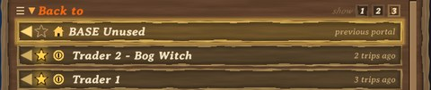

**8. "Last built"**
- The newest portals built by anyone on the server.
- **show 1 2 3 4 5** in the title: how many to list (default 3).
- 🌐 Shared: the same list for everybody. 👤 Personal: how many you see (per PC).

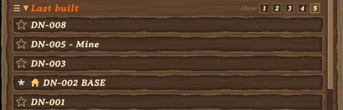

**9. "Players' last trips"**
- The last portal each other player travelled to, with their initial, name and how long ago. Click it to follow them.
- Only players who are online right now are shown; when nobody else is online, the whole block is hidden.
- **Players: 2 of 3** in the title opens a window: tick the players you want to follow.
- 🌐 Shared: every player's last trip (stored on the server).
- 👤 Personal: whom you follow (per character, saved on your PC).

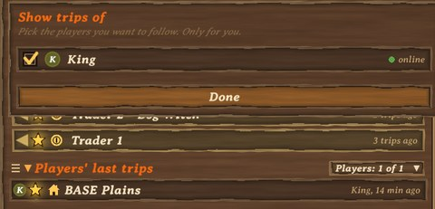

**10. Automatic names & the Edit portal window**
- New portals are named after their biome plus a number, for example `BF-007` or `MO-012`. Numbers keep counting up per biome and are never reused.
- Portals you name yourself, and existing portals, keep their names.
- Press **E** on a name in the list, on a map pin, or on a portal in the world: one compact window edits the portal's **name** (up to 25 characters), **type** (category) and **colour**.
- **Own...** next to Vanilla opens a small picker for any colour you like; **Use** brings it back to the edit window.
- Nothing is written until **Save** (Enter): name, type and colour are saved together. **Cancel** (Esc) keeps everything as it was.
- In the world, wards still decide who may edit a portal, as in the game. With a gamepad the game's own text box is used for the name, so the on-screen keyboard still works.
- 🌐 Shared: portal names, types and colours (anyone can change them).

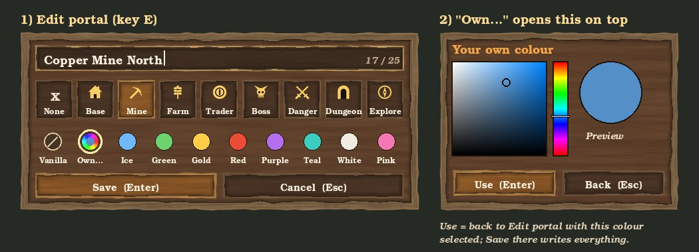

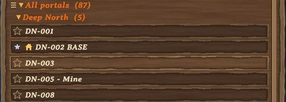

**11. Map pins**
- Every portal gets a fiery ring pin with its name, and its category icon in a round badge at the lower right.
- The previewed portal's pin is drawn bigger and stays big as long as the fiery line is shown; a pin under the mouse grows a little, so icon and name are easy to read.
- Pins from other mods (for example automatic pin mods) that sit on a portal are hidden, so each portal shows just one icon.
- While you choose a destination, portal pins, their names and the fiery line are drawn above all other pins and labels, at full brightness.
- 🌐 Shared: everybody sees the same pins, names and icons.

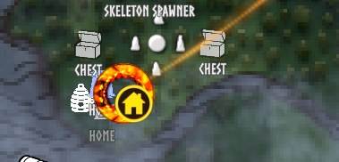

**12. One-way links and portal colours**
- **Link a portal to one destination**: walk into a linked portal and you travel straight there, without the list, just like the game's own portal pairs. Handy for a direct road between two bases.
- Standing in a portal, hover another portal in the list or on the map and press **L**, or right click it → **Link…**. A window in the middle of the screen shows **From** and **To**: walking into "From" takes you to "To". **Change…** picks another portal for either end, **Swap** turns the direction. Choose **both ways** (default) or **one way**, and a colour.
- Looking at a portal in the world: **L** links it (the map opens to pick the destination), or removes its link (press L twice).
- Linked portals show the destination's name floating above them in gold Viking letters (within 20 m), and "Leads to: …" in their hover text. In the list: "Mine → BASE Plains".
- From any other portal you can still travel *to* a linked portal as usual. If a destination is destroyed, the link is dropped.
- **Colours**: any portal can glow in one of 8 colours (Ice, Green, Gold, Red, Purple, Teal, White, Pink), in any colour of your own from the picker (drag in the square and the hue bar, then **Use this colour** or Enter), or keep the vanilla look. Press **C** (on a name, a pin, or a portal in the world) or right click → Colour. The colour shows on the portal's runes, in the fire around it and as a darker shade in the swirl in the middle, as a ring around its map pin and as a mark on its row.
- Portals with the same name never link each other.
- 🌐 Shared: links and colours (anyone can change them).

**13. Quick arrival**
- The game's own teleport always waits 2 seconds before it moves you and at least 8 seconds in total, even when the target area is already loaded.
- Trips through Portaler skip those fixed waits: you are moved as soon as the screen is dark, and you arrive as soon as the target area is loaded and there is ground under you.
- Measured: trips that took 8.6-10.5 s now take 4-6 s. Areas that load slowly still take as long as they need: you never arrive before the area is ready, and the game's own safety (15 s) still applies.
- Only Portaler trips are affected; vanilla portals and dungeon entrances stay as they are. If [Fast Teleport](https://www.nexusmods.com/valheim/mods/1774) is installed, Portaler leaves the timing to it. With TeleportEverything (QuickTeleport), Portaler trips keep Portaler's own quick arrival.
- 👤 Personal: on by default, `[Travel] QuickArrival` in your config.

**14. Optional vanilla restrictions**
- By default every item can travel, metals included.
- Prefer the game's own rules? Switch on `VanillaRestrictions` on the server (see Configuration).
- 🌐 Shared: the server decides for everybody.

**15. Gamepad support**
- Play with a controller (or on Steam Deck): move through the list with the D-pad, **A** travels, **X** sets a favorite, **Y** opens the portal menu, **B** closes. The map previews the portal you are on, just like hovering with the mouse.
- Every Portaler window (menu, colour, category, link, players) works with the D-pad and **A** / **B**. See Controls for all buttons.
- The search box and the **Show:** category filter still need a mouse or keyboard.
- 👤 Personal: setting `[Controls] Gamepad` (on by default).

**16. Back to your grave**
- After you die, the first portal you walk into shows a small window: **Nearest to your grave** (the portal closest to your newest grave marker) and **Last trip** (where you went before you died), each with its distance. Same portal for both: one button.
- Press **1** or **2** (Enter = the first one), click a button, or **Close** (Esc) to use the list as usual. It shows once per death.
- It uses the game's own grave marker on your map; if you removed the marker, the window does not show.
- 👤 Personal: setting `[List] GraveDialog` (on by default).

**17. Arrow keys**
- Arrow keys up / down move through the list, left / right jump between groups, **Enter** travels. The windows (menu, colour, category, link, players, grave) work the same way.
- Moving the mouse switches back to mouse control.
- 👤 Personal.

All shared data is stored on the server, next to the world save, and survives restarts and mod updates.

<b>Controls</b> (click to show)

| Action | How |
|---|---|
| Open the portal list | Walk into any portal |
| Travel | Left click a name in the list, or a portal pin on the map |
| Favorite: mine / shared / off | Click the star of a name (or right click → Favorite) |
| Portal menu | Right click a name or a portal pin: travel, link, remove link, colour, favorite, category, rename |
| Link a portal | Standing in a portal: hover a name or pin and press **L**. Looking at a portal in the world: **L** (press twice to remove a link) |
| Portal colour | Hover a name or pin, or look at a portal, and press **C** |
| See a portal on the map | Hover its name for a moment |
| Edit a portal (name, type, colour) | Hover its name or pin (or look at the portal) and press **E**; Enter saves all, Esc cancels |
| Set a category | Hover its name and press **T**, click a category (Esc closes) |
| Show one category | Click its icon in the **Show:** row; click again or **All** for everything |
| Reorder favorites | Drag a favorite by its handle (the three lines on the left) |
| Search | Click the search box, type part of a name; Esc or x clears it |
| Go back | Click a row under "Back to" at the top of the list; **show 1 2 3** sets how many |
| Follow other players | Click **Players: n of m** in "Players' last trips", tick names, **Done** |
| Reorder blocks | Drag Back to, Favorites, Players' last trips, Last built or All portals by the handle left of the title |
| Fold / unfold a group | Click the group title |
| Change sorting | Click **Biome**, **Name** or **Distance** at the top of the list |
| Reverse sorting | Click the active sort button again |
| Scroll the list | Mouse wheel over the list |
| Close | **Close** button, Esc, or walk out of the portal |
| Move with the keyboard | Arrow keys up / down (left / right = groups), **Enter** travels; moving the mouse ends it |
| After a death | The first portal shows "You died": **1** = nearest to your grave, **2** = last trip, Esc = close |

**Gamepad** (when you play with a controller; moving the mouse switches back to mouse control):

| Action | Button |
|---|---|
| Move in the list | D-pad up / down or right stick (hold to move faster) |
| Jump to the previous / next group | D-pad left / right |
| Travel | **A** |
| Favorite on / off | **X** |
| Portal menu (link, colour, category, rename…) | **Y** |
| Change sorting (Biome / Name / Distance) | **LB** / **RB** |
| Close the list | **B** |
| In a window (menu, colour, category, link, players) | D-pad chooses, **A** presses, **B** goes back |
| Own colour in the colour window | Right stick = saturation / brightness, **LB** / **RB** = hue, then **Use this colour** |
| Pan / zoom the map | Left stick / triggers, as in the game |

<b>Configuration</b> (click to show)

Config file: `BepInEx/config/nfp007.Portaler.cfg` (created on first start). `[Server]` settings: only the **server's** (or the host's) value counts; it is sent to all players. All other settings are personal (each PC).

| Setting | Default | What it does |
|---|---|---|
| `[Controls] RenameKey` | `E` | Key to rename the hovered portal. Any Unity key name, e.g. `R`, `F2`. |
| `[Controls] CategoryKey` | `T` | Key to choose the hovered portal's category. |
| `[Controls] LinkKey` | `L` | Link the portal you stand in to the hovered name or pin; in the world: link or unlink the portal you look at. |
| `[Controls] ColorKey` | `C` | Choose the colour of the hovered name, pin, or the portal you look at. |
| `[List] GraveDialog` | `true` | After a death, the first portal you walk into offers the portal nearest your grave and your last trip. |
| `[Controls] Gamepad` | `true` | Use the portal list with a gamepad (see Controls). `false` = the gamepad works on the map as in the vanilla game. |
| `[World] FloatingNames` | `true` | Show the destination's name above linked portals near you. |
| `[World] FloatingNameDistance` | `20` | How close (metres) you must be to see it. |
| `[World] FloatingNamePictureFont` | `true` | Write those names in the gold Portaler letters (`false` = normal game font). |
| `[List] DistanceOnEveryRow` | `true` | Show the distance on every row (`false` = only when sorted by distance). |
| `[Map] HoverShowsMap` | `true` | Hovering a name moves the map to that portal. |
| `[Map] HoverDelay` | `0.4` | Seconds the mouse must rest on a name before the map moves. |
| `[Map] HoverMaxFitMeters` | `2000` | Portals closer than this (metres) are framed together; farther targets are shown directly. |
| `[Map] HoverZoomMeters` | `1500` | For far targets: how much of the world is shown around the target (metres). |
| `[Map] HoverMoveSeconds` | `1` | Length of the calm glide to the preview and back. |
| `[Map] HoverReturn` | `true` | When the mouse leaves the list, the map glides back to where it was (not if you moved or zoomed the map yourself). |
| `[Map] HoverStaySeconds` | `10` | Seconds the preview stays after the mouse leaves the list, before the map glides back. |
| `[Map] HoverLine` | `true` | Draw the fiery line from your portal to the previewed one. |
| `[Map] PinSizePreview` | `1.6` | Size of the previewed portal's pin (1 = normal), as long as the fiery line is shown. |
| `[Map] PinSizeHover` | `1.3` | Size of a portal pin while the mouse is over it on the map. |
| `[Travel] QuickArrival` | `true` | Trips through Portaler skip the game's fixed waits (2 s before moving, at least 8 s in total) and end as soon as the target area is loaded. Off automatically when Fast Teleport is installed. Stays on with TeleportEverything (QuickTeleport); set `false` to let QuickTeleport time Portaler trips. |
| `[Debug] PerfLog` | `false` | For troubleshooting: writes Portaler's time and memory use per frame, and the timing of every trip, to the BepInEx log every 10 seconds. |
| `[Server] VanillaRestrictions` | `false` | `false` = no restrictions, everything travels through every portal. `true` = the game's own rules: no metals/ores through the wooden portal, and the world modifiers "no portals" and "no portals during boss fights" apply. |

Everything else is set from inside the game:

| What | Where it is stored |
|---|---|
| Sort choice and list sizes (per PC); folded groups, group order, "Back to" history and followed players (per character) | `Portaler.prefs` in Valheim's data folder (`AppData\LocalLow\IronGate\Valheim`) |
| Favorites and their order, categories, links, colours, "Last built", players' last trips, name counters (per world) | `<world>.portaler.txt` next to the world save on the server |

- Keep `<world>.portaler.txt` together with your world backups.
- Deleting it resets favorites and "Last built". Numbering then continues from the highest existing portal number.

<b>Installation</b> (click to show)

Portaler must be installed on the **server and on every player**, with the same version everywhere.

**Players**
- Install with a mod manager (Gale, r2modman, Thunderstore Mod Manager), or
- manually: copy `Portaler.dll` to `BepInEx/plugins/Portaler/`.

**Dedicated server**
- Copy `Portaler.dll` to `BepInEx/plugins/Portaler/` on the server and restart it.

**Notes**
- Do not run it together with other portal-list mods (for example PotalMap).
- Single player and self-hosted worlds work too: your game is then the server.

<b>Dependencies</b> (click to show)

- [BepInExPack for Valheim](https://thunderstore.io/c/valheim/p/denikson/BepInExPack_Valheim/) 5.4.2351 or newer

<b>Source code & feedback</b> (click to show)

- Source code: [github.com/nfp007/portaler](https://github.com/nfp007/portaler)
- Bugs and ideas: [open an issue](https://github.com/nfp007/portaler/issues)
- Building from source: see [BUILDING.md](https://github.com/nfp007/portaler/blob/main/BUILDING.md)
- License: MIT

