# Portaler

**Every portal connects to every portal.** Step into any portal and the map opens with a list of all portals on the server. Pick a name or click a pin and you're there. There's no pairing and no tag matching, and by default no item restrictions.

Rest the mouse on a name and the map shows where it goes, with a fiery line from your portal to the target.

Built for servers that play together:
- **Favorites**, personal (silver) or shared with everyone (gold), in your own order.
- **Categories** with icons on the list and the map pins (base, mine, farm, trader, boss, danger, dungeon, explore), plus a one-click filter.
- **Players' last trips**: see where your friends went and follow them with one click.
- **Back to**: your last 1-3 departure portals, one click away.
- **Last built**: the newest portals on the server.
- **Search, sorting** (biome, name, distance), foldable groups and blocks you can drag into your own order.
- **Automatic names** by biome (`BF-007`, `MO-012`) and renaming any portal right from the list.

Everybody has the same rights: anyone can rename, set categories or change shared favorites. Everything shared is synced through the server and kept with the world save, so it survives restarts and mod updates.

## Screenshots

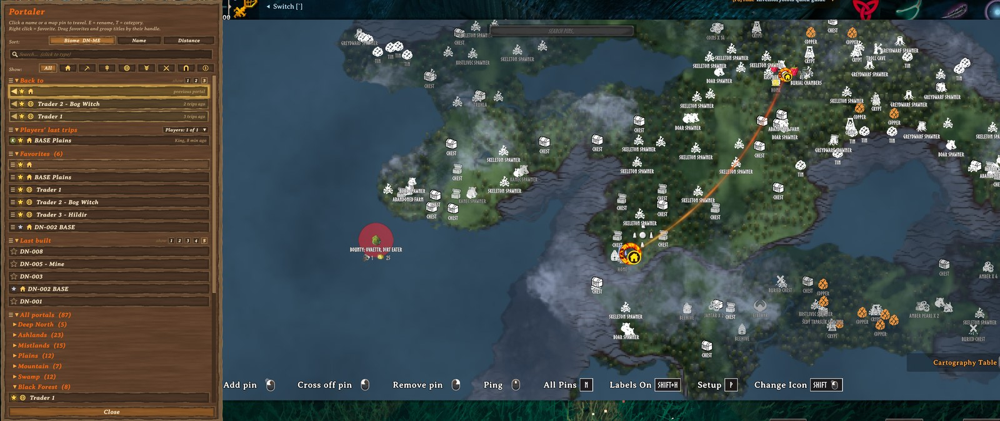

Source code, issues and ideas: **[github.com/nfp007/portaler](https://github.com/nfp007/portaler)**

## Features

Every feature says what is **🌐 shared** (the same for everybody on the server) and what is **👤 personal** (only for you).

**1. Travel from any portal to any portal**
- Walk into a portal: the big map opens with the portal list on the left.
- Click a name in the list, or a portal pin on the map, to travel.
- Vanilla name pairing is switched off, so every portal is always active.
- The portal you stand in stays in the list, greyed out with "you are here", and cannot be selected.
- 🌐 Shared: the list of portals (everybody sees every portal).

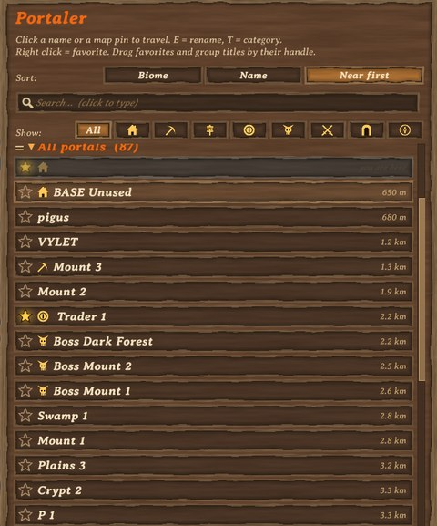

**2. Map preview**
- Rest the mouse on a name: a soft fiery line flows from your portal to it and its pin gets bigger, so you see where the trip goes.
- Close portals (up to 2 km apart): the map calmly frames **both** portals, with extra room around the target.
- Far portals: the map shows the target right away, without flying across the world.
- The map stays there 10 seconds after the mouse leaves the list, then glides back. Move or zoom the map yourself and it stays where you put it.
- 👤 Personal: only your own map moves. Timing, zoom and the line can be changed in your config.

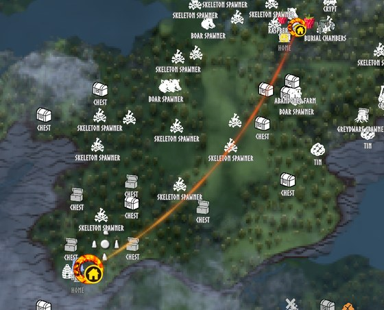

**3. Favorites**
- Right click a name: **mine** (silver star), then **shared** (bigger glowing gold star), then off.
- Drag favorites by their handle into any order. New favorites go to the end.
- 🌐 Shared: gold stars. Everybody sees them, and anyone can add or remove them.
- 👤 Personal: silver stars and the order of your favorites (per character, saved on the server).

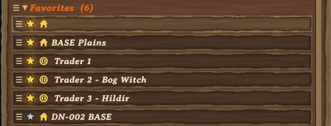

**4. Categories & filter**
- Hover a name and press **T** to choose a category: Base, Mine, Farm, Trader, Boss, Danger, Dungeon or Explore.
- The icon shows in the list and inside the portal's ring on the map.
- One click on an icon in the **Show:** row lists only that category. Click it again (or **All**) to see everything.
- 🌐 Shared: the category of each portal (anyone can change it).
- 👤 Personal: which category you are filtering by.

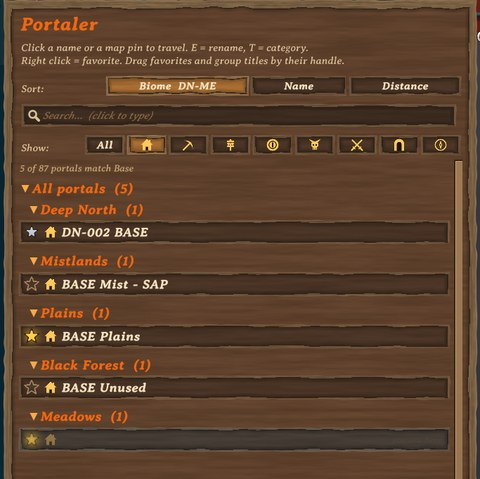

**5. Search**
- Click the search box and type: only portals whose name contains the text are shown (any case), matching letters in gold.
- While typing, the game ignores your keys (no walking, the map stays open). Esc or x clears the search.
- 👤 Personal: your search (cleared each time you enter a portal).

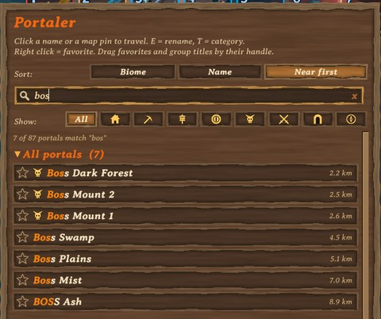

**6. Sorting & foldable groups**
- **Biome** (default): grouped by biome, Deep North first. Click again for Meadows first.
- **Name**: one list A to Z, or Z to A.
- **Distance**: nearest first (or farthest first), with the distance shown next to each name.
- Click a group title to fold or unfold it.
- Every block has a handle left of its title: **Back to**, **Favorites**, **Players' last trips**, **Last built** and **All portals** (the biome groups, or the sorted list). Drag them into any order, for example put Last built below all portals.
- 👤 Personal: sort choice (per PC), folded groups and group order (per character).

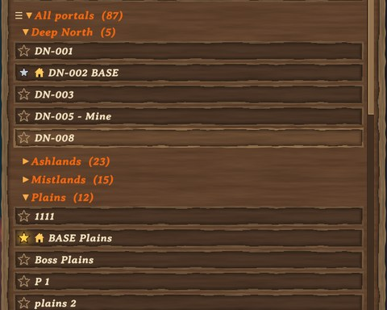

**7. "Back to"**
- The portals you last travelled from, at the top of the list. One click takes you back.
- The newest one is golden and glows; older ones say "2 trips ago", "3 trips ago".
- **show 1 2 3** in the title: how many to list.
- 👤 Personal: the history per character, the number per PC.

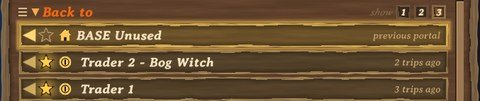

**8. "Last built"**
- The newest portals built by anyone on the server.
- **show 1 2 3 4 5** in the title: how many to list (default 3).
- 🌐 Shared: the same list for everybody. 👤 Personal: how many you see (per PC).

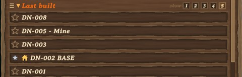

**9. "Players' last trips"**
- The last portal each other player travelled to, with their initial, name and how long ago. Click it to follow them.
- **Players: 2 of 3** in the title opens a window: tick the players you want to follow (online or offline).
- 🌐 Shared: every player's last trip (stored on the server).
- 👤 Personal: whom you follow (per character, saved on your PC).

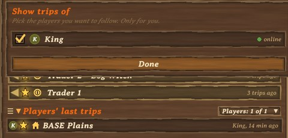

**10. Automatic names & rename from the list**
- New portals are named after their biome plus a number, for example `BF-007` or `MO-012`. Numbers keep counting up per biome and are never reused.
- Portals you name yourself, and existing portals, keep their names.
- Hover a name in the list and press **E** to rename that portal from anywhere in the world (up to 25 characters).
- 🌐 Shared: portal names (anyone can rename any portal).

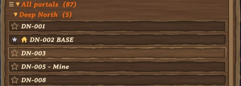

**11. Map pins**
- Every portal gets a fiery ring pin with its name, and its category icon in a round badge at the lower right.
- The previewed portal's pin is drawn bigger and stays big as long as the fiery line is shown; a pin under the mouse grows a little, so icon and name are easy to read.
- Pins from other mods (for example automatic pin mods) that sit on a portal are hidden, so each portal shows just one icon.
- While you choose a destination, portal pins, their names and the fiery line are drawn above all other pins and labels, at full brightness.
- 🌐 Shared: everybody sees the same pins, names and icons.

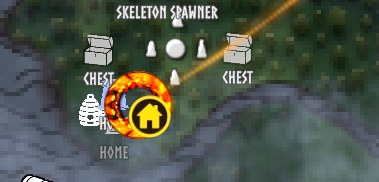

**12. Optional vanilla restrictions**
- By default every item can travel, metals included.
- Prefer the game's own rules? Switch on `VanillaRestrictions` on the server (see Configuration).
- 🌐 Shared: the server decides for everybody.

All shared data is stored on the server, next to the world save, and survives restarts and mod updates.

<b>Controls</b> (click to show)

| Action | How |
|---|---|
| Open the portal list | Walk into any portal |
| Travel | Left click a name in the list, or a portal pin on the map |
| Favorite: mine / shared / off | Right click a name (or click its star) |
| See a portal on the map | Hover its name for a moment |
| Rename a portal | Hover its name and press **E**, then Enter to save or Esc to cancel |
| Set a category | Hover its name and press **T**, click a category (Esc closes) |
| Show one category | Click its icon in the **Show:** row; click again or **All** for everything |
| Reorder favorites | Drag a favorite by its handle (the three lines on the left) |
| Search | Click the search box, type part of a name; Esc or x clears it |
| Go back | Click a row under "Back to" at the top of the list; **show 1 2 3** sets how many |
| Follow other players | Click **Players: n of m** in "Players' last trips", tick names, **Done** |
| Reorder blocks | Drag Back to, Favorites, Players' last trips, Last built or All portals by the handle left of the title |
| Fold / unfold a group | Click the group title |
| Change sorting | Click **Biome**, **Name** or **Distance** at the top of the list |
| Reverse sorting | Click the active sort button again |
| Scroll the list | Mouse wheel over the list |
| Close | **Close** button, Esc, or walk out of the portal |

<b>Configuration</b> (click to show)

Config file: `BepInEx/config/nfp007.Portaler.cfg` (created on first start). `[Server]` settings: only the **server's** (or the host's) value counts; it is sent to all players. All other settings are personal (each PC).

| Setting | Default | What it does |
|---|---|---|
| `[Controls] RenameKey` | `E` | Key to rename the hovered portal. Any Unity key name, e.g. `R`, `F2`. |
| `[Controls] CategoryKey` | `T` | Key to choose the hovered portal's category. |
| `[Map] HoverShowsMap` | `true` | Hovering a name moves the map to that portal. |
| `[Map] HoverDelay` | `0.4` | Seconds the mouse must rest on a name before the map moves. |
| `[Map] HoverMaxFitMeters` | `2000` | Portals closer than this (metres) are framed together; farther targets are shown directly. |
| `[Map] HoverZoomMeters` | `1500` | For far targets: how much of the world is shown around the target (metres). |
| `[Map] HoverMoveSeconds` | `1` | Length of the calm glide to the preview and back. |
| `[Map] HoverReturn` | `true` | When the mouse leaves the list, the map glides back to where it was (not if you moved or zoomed the map yourself). |
| `[Map] HoverStaySeconds` | `10` | Seconds the preview stays after the mouse leaves the list, before the map glides back. |
| `[Map] HoverLine` | `true` | Draw the fiery line from your portal to the previewed one. |
| `[Map] PinSizePreview` | `1.6` | Size of the previewed portal's pin (1 = normal), as long as the fiery line is shown. |
| `[Map] PinSizeHover` | `1.3` | Size of a portal pin while the mouse is over it on the map. |
| `[Server] VanillaRestrictions` | `false` | `false` = no restrictions, everything travels through every portal. `true` = the game's own rules: no metals/ores through the wooden portal, and the world modifiers "no portals" and "no portals during boss fights" apply. |

Everything else is set from inside the game:

| What | Where it is stored |
|---|---|
| Sort choice and list sizes (per PC); folded groups, group order, "Back to" history and followed players (per character) | `Portaler.prefs` in Valheim's data folder (`AppData\LocalLow\IronGate\Valheim`) |
| Favorites and their order, categories, "Last built", players' last trips, name counters (per world) | `<world>.portaler.txt` next to the world save on the server |

- Keep `<world>.portaler.txt` together with your world backups.
- Deleting it resets favorites and "Last built". Numbering then continues from the highest existing portal number.

<b>Installation</b> (click to show)

Portaler must be installed on the **server and on every player**, with the same version everywhere.

**Players**
- Install with a mod manager (Gale, r2modman, Thunderstore Mod Manager), or
- manually: copy `Portaler.dll` to `BepInEx/plugins/Portaler/`.

**Dedicated server**
- Copy `Portaler.dll` to `BepInEx/plugins/Portaler/` on the server and restart it.

**Notes**
- Do not run it together with other portal-list mods (for example PotalMap).
- Single player and self-hosted worlds work too: your game is then the server.

<b>Dependencies</b> (click to show)

- [BepInExPack for Valheim](https://thunderstore.io/c/valheim/p/denikson/BepInExPack_Valheim/) 5.4.2351 or newer

<b>Source code & feedback</b> (click to show)

- Source code: [github.com/nfp007/portaler](https://github.com/nfp007/portaler)
- Bugs and ideas: [open an issue](https://github.com/nfp007/portaler/issues)
- Building from source: see [BUILDING.md](https://github.com/nfp007/portaler/blob/main/BUILDING.md)
- License: MIT

